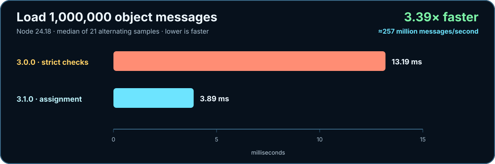
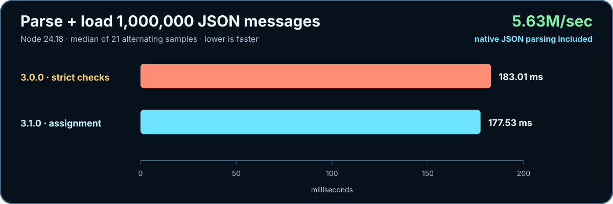
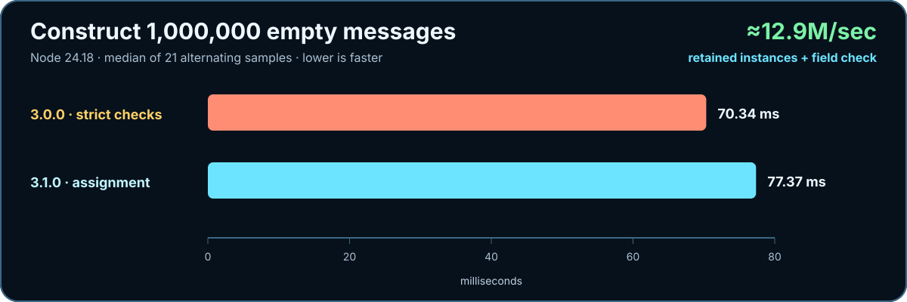

# js-message

A tiny, normalized JavaScript and JSON message envelope for every runtime boundary.

[Documentation](https://riaevangelist.github.io/js-message/) · [Why js-message](https://riaevangelist.github.io/js-message/why/) · [Get started](https://riaevangelist.github.io/js-message/guide/) · [API](https://riaevangelist.github.io/js-message/api/) · [Protocol](https://riaevangelist.github.io/js-message/protocol/) · [Browser](https://riaevangelist.github.io/js-message/browser/) · [Examples](https://riaevangelist.github.io/js-message/examples/) · [Playground](https://riaevangelist.github.io/js-message/playground/) · [Performance](https://riaevangelist.github.io/js-message/performance/) · [Testing](https://riaevangelist.github.io/js-message/testing/) · [Migration](https://riaevangelist.github.io/js-message/migration/)

[](https://github.com/RIAEvangelist/js-message/actions/workflows/ci.yml)
[](https://www.npmjs.com/package/js-message)
[](package.json)
[](package.json)
[](licence)

> **Current release:** js-message 3.1.0 is available on npm. It requires Node.js 22.13 or newer and gives ESM and CommonJS the same synchronous constructor.

`js-message` keeps the transport contract deliberately small:

```js
{
    type: 'event.or.message.name',
    data: { any: 'JSON-safe payload' }
}
```

Create the same shape in Node.js, browsers, WebSockets, workers, IPC, fetch, Electron, or any other JavaScript host. The package has no runtime dependencies, build, transpiler, or framework binding.

## Install

```sh
npm install js-message
```

## Quick start

```js
import Message from 'js-message';

const outgoing = new Message();
outgoing.type = 'user.updated';
outgoing.data = {
    id: 42,
    active: true
};

socket.send(outgoing.JSON);
```

Load the value at the other boundary:

```js
const incoming = new Message(receivedValue);

if (incoming.type === 'error') {
    console.error(incoming.data.err);
} else {
    route(incoming.type, incoming.data);
}
```

The constructor and `load()` accept either a JSON string or an existing message object. Senders may omit `type`, `data`, or both; missing fields remain `undefined` instead of becoming validation errors.

## Contract

| Surface | Behavior |
| --- | --- |
| `new Message([input])` | Creates fresh `type` and `data` fields; optionally loads an envelope. |
| `message.type` | Mutable message or event discriminator. Defaults to `''`. |
| `message.data` | Mutable payload. Defaults to a fresh `{}` per instance. |
| `message.JSON` | Normalized JSON string; keys whose values are `undefined` follow native omission rules. |
| `message.toJSON()` | Plain `{ type, data }` object for structured-clone transports and `JSON.stringify`. |
| `message.load(input)` | Parses text or copies available message fields; returns `undefined` for legacy compatibility. |

Fields are optional at load boundaries. For example, a signal that needs no payload stays small:

```js
new Message('{"type":"ping"}').JSON === '{"type":"ping"}';
```

Malformed or uncoercible input produces a recoverable error message:

```js
{
    type: 'error',
    data: {
        message: 'Invalid JSON response format',
        err: new SyntaxError('…'),
        response: originalInput
    }
}
```

The live `err` remains an `Error`. Its JSON form includes `name` and `message` instead of collapsing to `{}` when the preserved response is JSON-safe. A cyclic or `BigInt` response still follows native JSON behavior and throws.

## Imports

```js
// ESM
import Message, { Message as NamedMessage } from 'js-message';

// Supported direct module path
import LegacyMessage from 'js-message/Message.js';
```

```js
// CommonJS — the same Message.js constructor, not a duplicate build
const Message = require('js-message');
```

For a classic browser script:

```html
<script src="./node_modules/js-message/js-message-vanilla.js"></script>
<script>
    const message = new Message({
        type: 'page.ready',
        data: { ok: true }
    });
</script>
```

The global entry assigns `globalThis.Message` and is tested against the ES-module contract.

Node.js 22.13 and newer can synchronously `require()` this package's native ES module without an experimental warning. ESM and CommonJS therefore share one source file and one constructor identity.

## Why js-message

**Normalize once. Move messages anywhere.**

- Keep transport code focused on one tiny `{ type, data }` convention without imposing a payload schema.
- Omit fields that a signal does not need—no dummy `data: {}` payload on the wire.
- Share one constructor identity between ESM and CommonJS, with the same API available as a classic browser script.
- Recover malformed input as inspectable message data instead of scattering parser `try`/`catch` blocks through an application.
- Ship zero runtime dependencies, no generated Node build, and no framework binding.

[See the complete decision guide](https://riaevangelist.github.io/js-message/why/).

## Performance

**Less validation. More message.** Version 3.1 restores assignment semantics and removes the duplicate strict-envelope pass from 3.0.







The benchmark uses Node 24.18, one million operations, and the median of 21 alternating samples. [Review the method and recorded results](https://riaevangelist.github.io/js-message/performance/).

## Verification

Four focused suites use [vanilla-test](https://www.npmjs.com/package/vanilla-test) to run 76 nonduplicated shared checks from the same untransformed module in Node.js and Chrome. Chrome adds eleven distinct playground integration checks without inflating that shared count. CI also executes real ESM and CommonJS imports from the packed npm artifact, checks documentation and the declared runtime floor, and enforces native coverage.

```sh
npm ci
npm test
npm run test:unit
npm run test:functional
npm run test:integration
npm run test:regression
npm run test:playground
npm run coverage:node
npm run coverage:chrome
npm run test:package
npm run benchmark
npm start
```

The package, development tools, and coverage require Node.js 22.13 or newer. CI runs the complete suite at that exact floor and runs Node 24 across Linux, macOS, and Windows.

## License

[MIT](licence)
